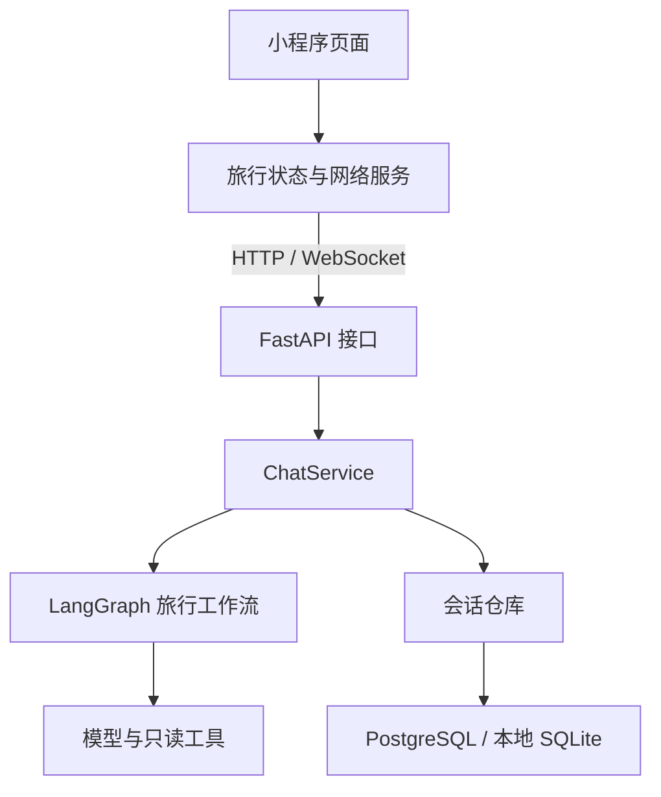

# 远行 Roam 架构

以 [Jevon-Zhong/agent-trip-planner](https://github.com/Jevon-Zhong/agent-trip-planner) 为参考，采用「微信小程序 → FastAPI 接口 → 聊天服务 → LangGraph / 数据仓库」的前后端分离架构。本项目按自己的接口和数据模型独立实现。

## 与参考项目的对应关系

| 层次 | 参考项目 | 当前实现 |
| --- | --- | --- |
| 小程序 | Uni-app、Vue 3、Pinia | 继续使用已有 Taro、React 页面；领域、状态、服务已分层 |
| 接口 | FastAPI controllers、schemas | `backend/app/api`、`schemas` |
| 业务服务 | `services/chat.py` | `backend/app/services/chat.py`，负责请求生命周期与历史上下文 |
| Agent 编排 | LangGraph 状态图 | `backend/app/graphs/travel.py`，规划、专业助手工具循环、最终回复 |
| 数据 | PostgreSQL、LangGraph checkpoint | PostgreSQL + SQLAlchemy 会话仓库；本地兼容 SQLite，暂不存工具执行 checkpoint |
| 实时通信 | WebSocket 回复、工具事件 | `accepted/status/delta/final/done/error/cancelled` 明确事件协议 |
| 外部工具 | 百炼 MCP、腾讯地图、腾讯云语音 | 百度托管 MCP 提供只读地图查询，可切换直接 Web API；保留配置后的 Amadeus 工具，语音待接入 |
| 身份 | 微信账号登录 | 当前安装凭证；微信账号级身份待接入 |

## 调用关系

## 代码边界

| 路径 | 职责 |
| --- | --- |
| `miniapp/src/pages` | 页面、输入与展示 |
| `miniapp/src/domain/travel.mjs` | 旅行偏好、收藏、草稿、示例聊天、本地会话状态；无微信平台依赖 |
| `miniapp/src/stores/travel.ts` | 组合领域逻辑与微信服务，向 React 页面提供状态和动作 |
| `miniapp/src/services` | 微信请求、存储、WebSocket、历史接口 |
| `backend/app/api/chat.py` | 请求解析、鉴权入口、HTTP 状态码、连接与取消 |
| `backend/app/schemas/chat.py` | 入参限制与助手类型 |
| `backend/app/services/chat.py` | 上下文加载、重试、超时、部分回复保存、完成事件 |
| `backend/app/graphs/travel.py` | 任务分配、工具循环、公开回复事件；不操作业务数据库 |
| `backend/app/core/llm.py` | 按环境配置创建模型；导入时不初始化付费服务 |
| `backend/app/tools/catalog.py` | 按服务端凭据选择可用的只读工具；未配置的供应商不发起空凭据查询 |
| `backend/app/tools/baidu.py` | 百度地点、天气和路线的模型工具与参数约束 |
| `backend/app/services/baidu_maps.py` | 百度 Web API 调用、可选 SN 签名、结果精简与脱敏错误 |
| `backend/app/services/baidu_mcp.py` | MCP Streamable HTTP 会话、工具发现、只读目录、参数检查、错误与日志脱敏 |
| `backend/app/check_mcp.py` | 不暴露密钥的 MCP 连接及业务查询自检 |
| `backend/app/repositories/chat.py` | 身份校验、会话读写、所有权、并发控制 |
| `backend/app/models/chat.py` | 会话、安装凭证、消息轮次表 |
| `backend/app/core/database.py` | PostgreSQL / SQLite 驱动选择与连接 |

原网页、旧助手及其接口已移除。小程序使用独立的聊天服务；航班与酒店等共用查询工具仍由当前助手使用。

## 数据与恢复语义

- 示例对话、收藏、偏好、草稿保存在微信本地缓存；服务端数据库保存真实对话。
- `DATABASE_URL` 非空时选择 PostgreSQL；未配置时读取 `TRAVEL_CHAT_DB` 或 `.data/chat.sqlite3`。
- 既有 SQLite 表和凭证继续可读。切换到 PostgreSQL 是连接另一份数据库，不自动迁移历史。
- PostgreSQL 对当前安装的设备行加事务锁；SQLite 写事务使用 `BEGIN IMMEDIATE`。同一会话不接受并行轮次。
- 相同安装、相同请求编号且内容一致的已完成请求，直接返回保存的回复。中断请求重试复用原轮次，模型与只读工具可能再次执行。
- 先保存完整回复再发送 `done`；客户端只在 `done` 后确认完成。断开或取消保存部分回复，完成记录不会被迟到的中断覆盖。
- 上下文从最后 20 个成功轮次重建。当前不提供执行到某次工具调用的持久 checkpoint 恢复。
- 安装凭证随机生成，数据库保存其哈希。WebSocket 凭证位于首条消息内，不放在 URL 中。

## 下一步扩展位置

百度地图支持 `BAIDU_MAP_TRANSPORT=mcp` 或 `webapi`。MCP 模式使用官方 Python SDK，在地图助手实际运行时发现远程工具，按只读白名单筛选后交给 LangGraph；酒店助手仅获得地点和行政区划工具。每次操作独立创建并关闭会话，取消时清理连接。远程工具异常转换为不含 AK 的错误，服务开通错误不会作为查询成功展示。

地点坐标默认为 BD-09，MCP 不同工具的经纬度顺序有差异，保留原工具 Schema 中的字段说明；未来在微信地图中绘制时需按组件要求转换坐标。天气保留供应商返回的更新时间与预报日期，不能当作长期预测。酒店地点仅代表地理信息，不代表可售库存或预订价。

微信登录应接入身份服务，将安装身份替换为受验证的用户身份。后续地图可视化与语音通过各自业务服务提供接口。涉及外部服务的密钥只在 Python 服务端配置。新增这些能力前，不把它们显示成已可用功能。

生产数据库已有表结构后，后续字段变更应使用版本化迁移；当前初始化只创建缺失表，不修改已有列。部署指引见仓库 README。
